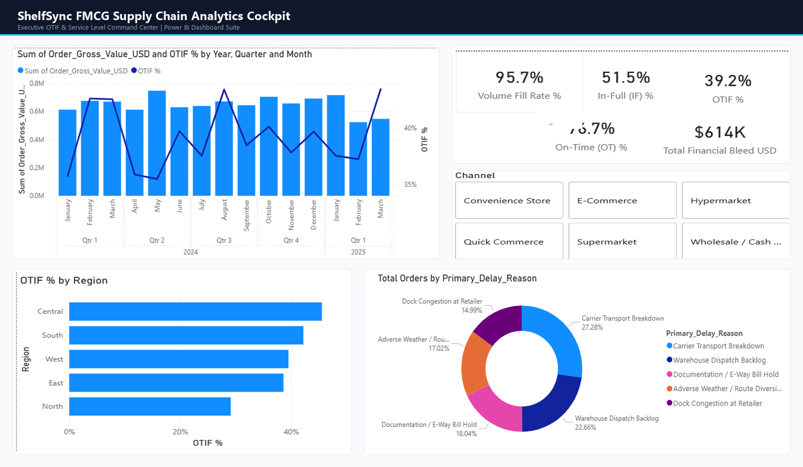
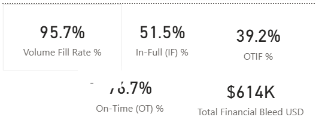
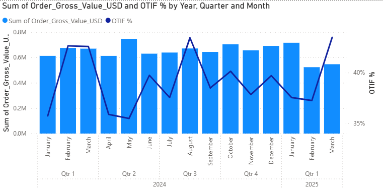
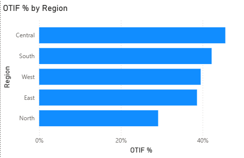
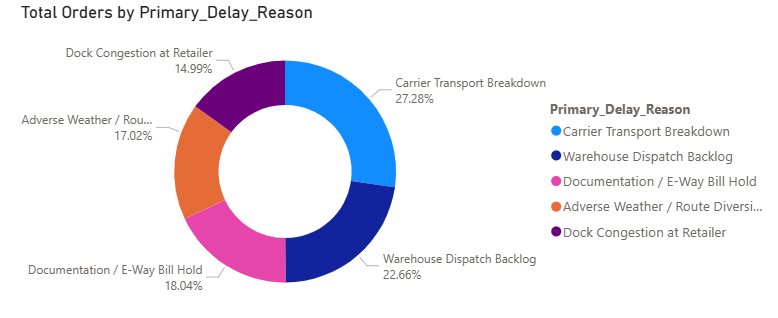
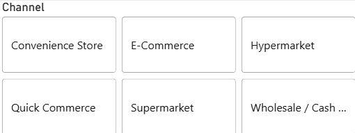

# ShelfSync: FMCG Supply Chain Analytics & Power BI Solution

[](https://en.wikipedia.org/wiki/Fast-moving_consumer_goods)
[](https://powerbi.microsoft.com/)
[](https://learn.microsoft.com/en-us/dax/)
[](https://python.org)
[](#interactive-power-bi-dashboard-shelfsyncpbix)

> **Executive Summary:**  
> An enterprise-grade Power BI & data analytics solution for **ShelfSync FMCG Ltd.**, supplying 20 Tier-1 modern trade retail partners (Hypermarkets, Supermarkets, Quick Commerce). While internal logistics celebrated a **95.73% Volume Fill Rate** ("The Fill Rate Illusion"), customer-facing delivery performance collapsed to **39.18% OTIF (On-Time In-Full)** against an agreed $\ge 92.00\%$ contractual SLA.  
> This operational breakdown caused **$614,088 in annual financial bleed** ($420K in stockout lost sales + $194K in cash chargeback penalties). Through dimensional Star Schema modeling, 35+ custom DAX measures, and root-cause Pareto diagnostics, this project exposes the choke points and establishes a 5-pillar transformation playbook delivering a **3.8x ROI ($430K net year-1 cash recovery)**.

---

## Live Dashboard Overview



---

## Interactive Power BI Dashboard (`ShelfSync.pbix`)

The completed, fully interactive Power BI report is saved directly in the root of this repository:
- **File:** [`ShelfSync.pbix`](ShelfSync.pbix) *(Open directly in Power BI Desktop)*

### 1. Executive Service Level KPIs (The "Fill Rate Illusion")

- **The Divergence:** While internal operations reported **95.7% Volume Fill Rate**, customer-facing order completion was **39.2% OTIF**.
- **Financial Bleed:** **$614K** total loss directly eroding gross margin ($420K lost sales + $194K cash penalties).

---

### 2. Monthly OTIF Trend vs Purchase Order Gross Volume

- Dual-axis visualization showing gross order volume ($0.5M - $0.8M/month) vs volatile OTIF performance.
- Highlights the severe Q2 summer collapse where OTIF plunged to **35%** due to cold-chain dairy bottlenecks.

---

### 3. Regional Bottlenecks & Delay Root-Cause Diagnostics

| Regional OTIF Breakdown | Delay Reason Pareto Breakdown |
|:---:|:---:|
|  |  |
| **North Region Bottleneck:** Gurugram hub drops to **29.1% OTIF** (+0.69 days delay). | **Top Delays:** Carrier breakdown (27.3%) & Warehouse backlog (22.7%). |

---

### 4. Interactive Channel Filtering

- Slicers across **Convenience Stores, E-Commerce, Hypermarkets, Quick Commerce, Supermarkets, and Wholesale**.
- Selecting **Quick Commerce** reveals the SLA trap: 5% penalty rate generating 35.2% of all company penalties.

---

## Repository Structure

```
ShelfSync/
├── ShelfSync.pbix                     # Completed interactive Power BI report file
├── assets/
│   └── images/                        # High-resolution dashboard screenshots & visual assets
│       ├── dashboard_overview.png
│       ├── executive_kpi_cards.png
│       ├── monthly_otif_sales_trend.png
│       ├── regional_otif_breakdown.png
│       ├── delay_root_causes_donut.png
│       └── channel_slicer.png
├── data/
│   └── raw/
│       ├── dim_customers.csv          # 20 Tier-1 retail accounts across 5 channels
│       ├── dim_products.csv           # 28 SKUs across 5 FMCG categories with velocity & shelf-life
│       ├── dim_warehouses.csv         # 6 Regional distribution centers with capacity & SLA specs
│       ├── dim_date.csv               # Comprehensive 456-day date calendar (2024 to Q1 2025)
│       ├── fact_orders.csv            # 3,800 Purchase orders with lead times, flags, and penalties
│       ├── fact_order_lines.csv       # 15,166 Order line item fulfillment records
│       └── fact_forecast_accuracy.csv # 8,400 Monthly S&OP demand forecast vs actuals records
├── scripts/
│   ├── generate_fmcg_supply_chain_data.py # Reproducible data generator with real operational patterns
│   └── run_diagnostics.py                 # Statistical engine computing exact KPIs & root causes
├── powerbi/
│   ├── star_schema_architecture.md        # Dimensional Kimball star schema, keys & relationships
│   ├── dax_measures_library.md            # 35+ Production-ready DAX measures with formatting
│   └── dashboard_wireframes_and_spec.md   # Complete 4-page UI/UX wireframes & design system
├── insights/
│   ├── executive_supply_chain_report.md   # C-Suite diagnostic report on OTIF crisis & financial bleed
│   ├── strategic_action_playbook.md       # 5-Pillar 30-60-90-180 day transformation roadmap
│   └── presentation_script_and_talking_points.md # Interview & executive presentation script
└── README.md                              # Master project blueprint and portfolio showcase
```

---

## Key Performance Indicators (KPIs)

| Metric Category | KPI Name | Formula / Logic | Benchmark | Actual Value | Status |
|---|---|---|---|---|---|
| **Service Level** | **Order OTIF %** | $\frac{\text{Orders (On-Time AND In-Full)}}{\text{Total Orders}}$ | $\ge 92.00\%$ | **39.18%** | 🔴 Critical Breach |
| **Service Level** | **On-Time (OT) %** | $\frac{\text{Orders Delivered on or before Promised Date}}{\text{Total Orders}}$ | $\ge 95.00\%$ | **76.66%** | 🟡 At Risk |
| **Service Level** | **In-Full (IF) %** | $\frac{\text{Orders with 100% Lines Delivered}}{\text{Total Orders}}$ | $\ge 96.00\%$ | **51.47%** | 🔴 Severe Failure |
| **Internal Efficiency** | **Volume Fill Rate %** | $\frac{\text{Total Delivered Units}}{\text{Total Ordered Units}}$ | $\ge 98.00\%$ | **95.73%** | ⚠️ The "Fill Rate Illusion" |
| **Financial Impact** | **Lost Sales Revenue** | $\sum(\text{Short Qty} \times \text{Unit Wholesale Price})$ | $\$0$ | **$420,261.80** | 🔴 Severe Drain |
| **Financial Impact** | **SLA Penalties Levied** | $\sum(\text{Failed Order Gross Value} \times \text{Customer Penalty Rate})$ | $\$0$ | **$193,825.78** | 🔴 Margin Erosion |
| **Financial Impact** | **Total Financial Bleed**| $\text{Lost Sales} + \text{Penalties}$ | $\$0$ | **$614,087.58** | **6.31% of Gross Sales** |
| **Demand Accuracy** | **WAPE % (Weighted Error)**| $\frac{\sum |\text{Actual} - \text{Forecast}|}{\sum \text{Actual}}$ | $\le 5.00\%$ | **13.1% (Beverage/Dairy)**| 🟡 High Error |

---

## 5-Pillar Strategic Transformation Playbook (3.8x ROI)

1. **Gurugram Cross-Docking & Pick-to-Light Sortation:** Slashes turnaround time from 16.5 hrs to 4 hrs.
2. **Dedicated Quick Commerce Dark Pods:** Pre-buffers top-12 high-velocity SKUs to eliminate 5% chargebacks.
3. **Cold-Chain IoT & Automated FEFO Gate:** Enforces $>75\%$ remaining shelf life before dispatch.
4. **Automated E-Way Billing API & Carrier Scorecards:** Saves 4-8 hours of gate delay and ties carrier bonuses to On-Time rates.
5. **Demand Sensing & Kingman Dynamic Buffers:** Dynamically expands safety stocks during peak seasonal surges.

> **Projected ROI:** Recovers **$580,000+ in annual bleed** against a $150,000 investment (**+$430,000 Net Year-1 Cash Flow Benefit**). Read the complete guide in [`strategic_action_playbook.md`](insights/strategic_action_playbook.md).

---

## Quick Start Guide

1. Clone repository:
   ```bash
   git clone https://github.com/BioSOnline/ShelfSync-FMCG-Supply-Chain-Analytics.git
   ```
2. Double-click **[`ShelfSync.pbix`](ShelfSync.pbix)** to open the live interactive dashboard in Power BI Desktop.
3. Read the presentation and interview talking points in **[`presentation_script_and_talking_points.md`](insights/presentation_script_and_talking_points.md)**.
